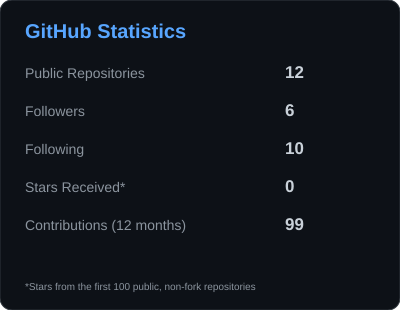
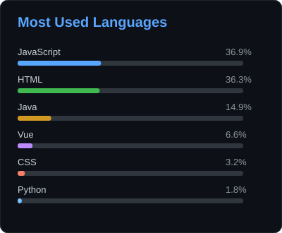
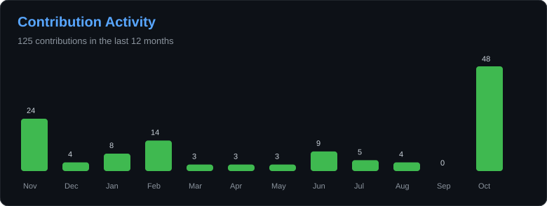

# Hey, I'm TJ 👋

Developer from Germany 🇩🇪

I enjoy working on software projects, experimenting with different technologies, and figuring out how things work behind the scenes.

 

---

## About Me

I'm interested in software development, infrastructure, and the technical side of how applications and systems work.

Most of my time is spent working on projects, exploring new tools, or improving things I've already built.

- 💻 Interested in software development and infrastructure
- 🔧 Enjoy working on practical projects and experimenting with new technologies
- 🌐 Interested in web development, backend systems, and self-hosting
- 📂 You can find my public projects and experiments in my repositories

---

## Technologies & Tools

---

## GitHub Statistics

  

---

## Projects

I use GitHub to share projects, keep track of things I'm working on, and experiment with different ideas.

Some repositories are finished projects, while others are smaller experiments or things I'm still developing.

---

## Contact

Feel free to explore my repositories or reach out on Discord.

